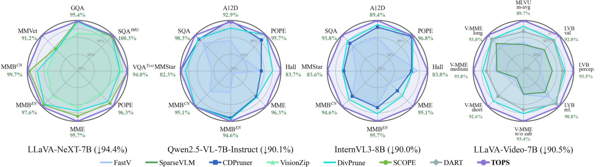
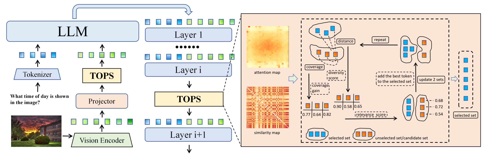
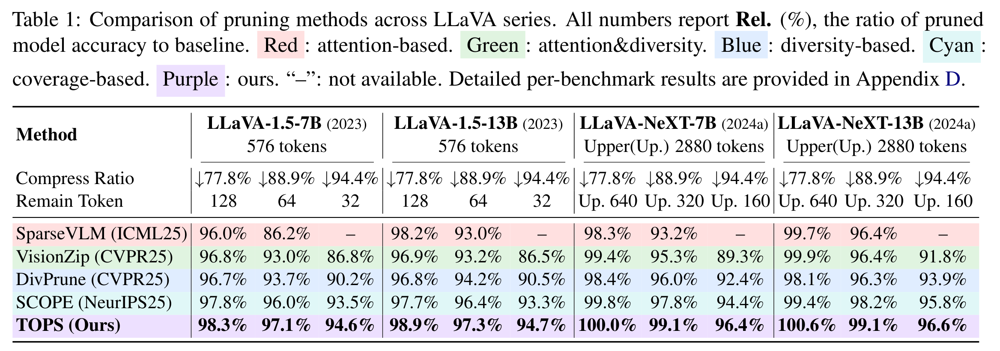
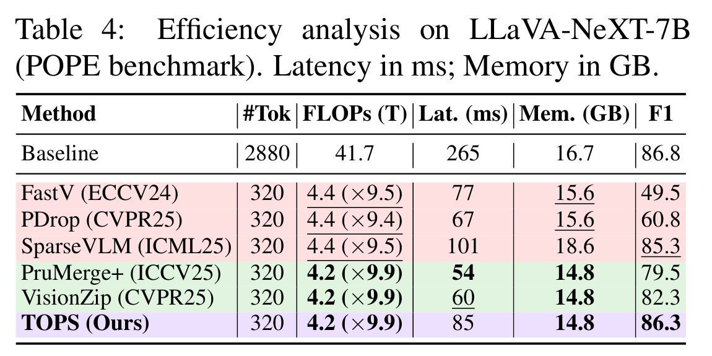
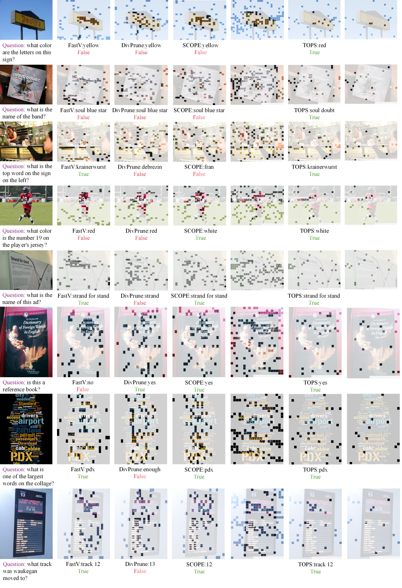

<div align="center">

# TOPS

### First-Principles Visual Token Pruning via<br>Constructing Token Optimal Preservation Sets for Efficient MLLM Inference

<p align="center">
Tinghao Wang<sup>1,2,*</sup>, Yichen Guo<sup>1,3,*</sup>, Rui Huang<sup>2,*,†</sup>, Junchi Yao<sup>4</sup>, Qizhe Zhang<sup>1</sup>,<br>
Zheng Lu<sup>2</sup>, Yuan Zhang<sup>1</sup>, Jiajun Cao<sup>1</sup>, Zhirong Shen<sup>2</sup>, Yaosong Du<sup>2</sup>,<br>
Lijie Hu<sup>4</sup>, Shanghang Zhang<sup>1,‡</sup>
</p>

</div>

<p align="left">
<sup>1</sup> State Key Laboratory of Multimedia Information Processing, School of Computer Science, Peking University<br>
<sup>2</sup> University of Electronic Science and Technology of China<br>
<sup>3</sup> Nanyang Technological University<br>
<sup>4</sup> MBZUAI
</p>

<div align="center">

<p align="center">
<sup>*</sup> Equal contribution. &nbsp; <sup>†</sup> Project leader. &nbsp; <sup>‡</sup> Corresponding author.
</p>

**Task relevance · Information coverage · Semantic diversity**

[Paper](https://arxiv.org/abs/2606.27161) · [Method](#method) · [Results](#results) · [Quick start](#quick-start) · [Evaluation guide](docs/RUNNING.md)

</div>

---

TOPS constructs a compact visual token set by jointly considering **what matters to the question, what evidence is covered, and what information is complementary**. A training-free, multi-stage pipeline applies these principles before and within the language model.

<table>
<tr>
<th align="center">77.8% visual tokens pruned</th>
<th align="center">100.6% relative performance</th>
<th align="center">7 MLLM backbones</th>
</tr>
<tr>
<td align="center">LLaVA-NeXT · 640-token budget</td>
<td align="center">LLaVA-NeXT-13B · T = 640</td>
<td align="center">Image & video understanding</td>
</tr>
</table>

<a href="assets/teaser-results.pdf"></a>

> Figures and performance numbers are from the paper. Current code-release checks are reported separately under [Validation](#validation).

## Method

<a href="assets/method.pdf"></a>

- **Task relevance:** preserve tokens informative for the user query.
- **Information coverage:** represent evidence in the original visual set.
- **Semantic diversity:** favor complementary tokens over redundant ones.

TOPS combines these criteria in greedy subset selection. Stage 1 removes coarse visual redundancy; stage 2 performs text-aware refinement at designated LLM layers.

## Results

### LLaVA model family

<a href="assets/results-table.pdf"></a>

Relative performance is normalized to each model's unpruned baseline. The original table compares three token budgets across LLaVA-1.5 and LLaVA-NeXT at 7B and 13B scales.

### Inference efficiency

<p align="center">
<a href="assets/efficiency-table.pdf"></a>
</p>

The paper reports **4.2T FLOPs versus 41.7T** for the unpruned model at 320 tokens, with POPE F1 of **86.3 versus 86.8**. The table preserves the paper's original latency and memory measurements.

<details>
<summary><strong>Visual evidence retained by TOPS</strong></summary>

<a href="assets/qualitative.pdf"></a>

</details>

## Supported models

| Model family | Implementation | Environment |
| :--- | :--- | :--- |
| LLaVA-1.5 / LLaVA-NeXT · 7B & 13B | [LLaVA-TOPS](LLaVA-TOPS) | `fastv` |
| LLaVA-Video · 7B | [LLaVA-Video-TOPS](LLaVA-Video-TOPS) | `llavavid` |
| Qwen2.5-VL · 7B / InternVL3 · 8B | [VLMEvalKit-TOPS](VLMEvalKit-TOPS) | `vlmevalkit-qwen2.5vl` |

## Quick start

Choose the model family below. Each group includes environment setup and a runnable launcher example. Use **Linux with an NVIDIA GPU**, and download the model weights and benchmark data separately.

```bash
git clone https://github.com/MAX-7237/TOPS.git
cd TOPS
export REPO_ROOT="$PWD"
```

Run the setup block for the component you need. If its Conda environment already exists, skip `conda create` and activate it. Keep the environment profiles separate: image LLaVA, video LLaVA, and the Qwen families use different Transformers versions. Dependency pins and installation caveats are documented in the [environment guide](docs/RUNNING.md#environments).

The commands below run inference or evaluation directly, assuming the environment, datasets, and model weights are configured. Replace `/path/to/...` with your local paths.

### 1. LLaVA image models — four backbones

```bash
cd "$REPO_ROOT/LLaVA-TOPS"
conda create -n fastv python=3.10 -y
conda activate fastv
python -m pip install -r requirements.txt
python -m pip check
```

| Backbone | `--model` | `--tokens` choices |
| :--- | :--- | :--- |
| LLaVA-1.5-7B | `llava-1.5-7b` | `128`, `64`, `32` |
| LLaVA-1.5-13B | `llava-1.5-13b` | `128`, `64`, `32` |
| LLaVA-NeXT-7B (Vicuna) | `llava-next-7b` | `128`, `64`, `32` |
| LLaVA-NeXT-13B (Vicuna) | `llava-next-13b` | `128`, `64`, `32` |

**NeXT budget convention:** pass `128/64/32`; the five-view scaling corresponds to total budgets `640/320/160`. Do not pass those total budgets to the TOPS launcher.

Prepare the benchmark question JSONL and image directory, then choose one of the four commands:

```bash
python run_tops.py --model llava-1.5-7b --tokens 128 \
  --question-file /path/to/questions.jsonl --image-folder /path/to/images \
  --answers-file outputs/llava-1.5-7b/answers.jsonl

python run_tops.py --model llava-1.5-13b --tokens 128 \
  --question-file /path/to/questions.jsonl --image-folder /path/to/images \
  --answers-file outputs/llava-1.5-13b/answers.jsonl

python run_tops.py --model llava-next-7b --tokens 128 \
  --question-file /path/to/questions.jsonl --image-folder /path/to/images \
  --answers-file outputs/llava-next-7b/answers.jsonl

python run_tops.py --model llava-next-13b --tokens 128 \
  --question-file /path/to/questions.jsonl --image-folder /path/to/images \
  --answers-file outputs/llava-next-13b/answers.jsonl

```

The launcher selects the default Hugging Face model ID for each alias; use `--model-path /path/to/weights` for local image-model weights. These commands write predictions. Run the relevant benchmark scorer afterwards; MMBench and ScienceQA also provide dedicated evaluation modules under `llava/eval`.

### 2. LLaVA-Video — 7B Qwen2

Video has its own environment; do not install its dependencies into `fastv`.

```bash
cd "$REPO_ROOT/LLaVA-Video-TOPS"
conda create -n llavavid python=3.10 -y
conda activate llavavid
python -m pip install -r requirements.txt
python -m pip install --no-build-isolation -r requirements-flash-attn.txt
python -m pip check

python run_tops.py --model llava-video-7b --tokens 32 \
  --model-path lmms-lab/LLaVA-Video-7B-Qwen2 \
  --dataset videomme --nproc 1 --work-dir outputs/video
```

The adapter uses the Qwen conversation template and samples up to **64 frames**. The token budget is **per frame** (`64/32/16`). Prepare VideoMME according to `lmms-eval/lmms_eval/tasks/videomme`, or select another registered video task with `--dataset`. Predictions and evaluation artifacts go under `--work-dir`. The recovered video environment remains a candidate profile pending GPU validation.

### 3. Qwen2.5-VL and InternVL3

Both backbones share `vlmevalkit-qwen2.5vl` and the VLMEvalKit entry point.

```bash
cd "$REPO_ROOT/VLMEvalKit-TOPS"
conda create -n vlmevalkit-qwen2.5vl python=3.11 -y
conda activate vlmevalkit-qwen2.5vl
python -m pip install -r requirements.txt
python -m pip install --no-build-isolation -r requirements-flash-attn.txt
python -m pip check

# Qwen2.5-VL-7B-Instruct
python run_tops.py --model qwen2.5-vl-7b --tokens 256 \
  --dataset AI2D_TEST --nproc 1 --work-dir outputs/qwen25

# InternVL3-8B
python run_tops.py --model internvl3-8b --tokens 256 \
  --dataset AI2D_TEST --nproc 1 --work-dir outputs/internvl3
```

Use `--tokens 256` or `128`. Set `LMUData` to your dataset/cache directory when needed, and follow the selected VLMEvalKit dataset adapter's preparation instructions. To use local model weights, edit the matching entry in `vlmeval/config.py`; these VLMEval launchers do not accept `--model-path`. Some benchmarks require an external judge model in addition to inference.

FlashAttention must be built **after PyTorch**, with a compatible CUDA toolkit and compiler. See the [environment guide](docs/RUNNING.md#environments) for the pinned versions.

See the [full evaluation guide](docs/RUNNING.md#running) for additional configuration and scoring details.

## Validation

This is a **source-preview release**. Python syntax and 19 model/budget launcher dry runs pass. Full environment installation, real-weight GPU inference, and paper-result reproduction remain pending. See [validation records](VALIDATION.json) and the [configuration notes](docs/RUNNING.md#method-configuration).

Figures are copied from the original paper project; tables retain the original LaTeX content and formatting. Click previews for their PDFs. Source paths and hashes are recorded in [asset provenance](assets/SOURCES.json).

## Citation

```bibtex
@article{wang2026tops,
  title={TOPS: First-Principles Visual Token Pruning via Constructing Token Optimal Preservation Sets for Efficient MLLM Inference},
  author={Wang, Tinghao and Guo, Yichen and Huang, Rui and Yao, Junchi and Zhang, Qizhe and Lu, Zheng and Zhang, Yuan and Cao, Jiajun and Shen, Zhirong and Du, Yaosong and Hu, Lijie and Zhang, Shanghang},
  journal={arXiv preprint arXiv:2606.27161},
  year={2026}
}
```

## Acknowledgements

Built on LLaVA, LLaVA-NeXT/LLaVA-Video, VLMEvalKit, lmms-eval, and Transformers. Existing third-party licenses and attribution remain with their components.
